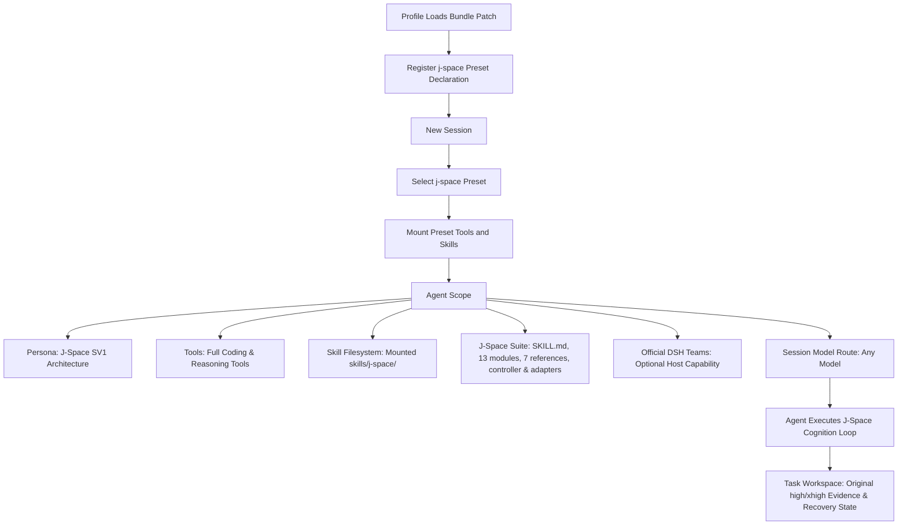

# dsh-j-space

[](https://dsh.market/?q=AnonyJcy%2Fdsh-j-space)
[](https://www.npmjs.com/package/@anonyjcy/dsh-j-space)
[](NOTICE.md)

[简体中文](README.md) | **English**

> **J-Space Cognition Suite SV1** native Agent Preset & standalone Cordis plugin for **DeepSeek Harness (DSH)**.  
> Original cognition induction, durable evidence and recovery; permissions and real agent lifecycle remain official DSH capabilities.

---

> **Validated target: DSH 0.2.1-alpha.3 with Cordis 4.0.5-alpha.2; project version: 1.2.4 (2026-10-15).** A fresh isolated installation through the official CLI verified the npm-packed artifact, real Loader preset activation, scoped skill discovery/loading, and official Team OFF/ON composition. J-Space owns cognition and task evidence; only the official DSH plugin manages Agent Teams. The preset does not register its own direct subagent tools. No model, actual Team turns, browser interaction, or scheduled delivery was exercised; these are not end-to-end capability claims.
>
> **Upgrade the correct host channel first.** On this date DSH's npm `alpha` is `0.2.1-alpha.3`, while `latest` remains the older `0.2.0-rc.2`; stable `0.2.1` is not published. A clean installation of that older `latest` lacks the required `@deepseek-ai/dsh-tool-schedule` and fails full preset activation. This release does not claim compatibility with that default composition; explicitly upgrade to the validated alpha.3 as shown below.
### DSH 0.2.1 adaptation highlights

- **1.2.0: native preset registration**. The `@deepseek-ai/dsh-agent-preset` declaration in [cordis.patch.yml](./cordis.patch.yml) registers the preset, with skills resolved relative to the package and no separate deployment step. Since DSH 0.1.7, `$DSH_HOME/.agent-presets/` is no longer scanned; copying files with the legacy CLI does not register a preset in 0.2.0.
- **1.2.1: standard tool composition**. Adds the `/goal` command and `present` deliverable tool, and sets `modelSelectionSettings: true` by default. The plugin-manager tool row remains disabled, matching the standard preset.
- **1.2.2: aligned defaults**. Enables `web_fetch` alongside `web_search` and explicitly disables Ralph. Keeps the J-Space-specific persona and skill directory.
- **1.2.3: development checks and legacy plugin lifecycle**. Adds Node.js type declarations and `pnpm run typecheck`; fixes the standalone plugin's file deployment, which waited for a `ready` event that Cordis 4 no longer emits. Native bundle registration is unchanged.
- **1.2.4: official Team ownership**. Adds time context and scheduling; removes preset-local subagent / fork / control / list-agents and stale external-agent / Ralph rows. Preserves original orchestration evidence, second consideration and independent acceptance; the [DSH authority overlay](./preset/skills/j-space/integration/dsh.md) distinguishes local evidence participants from actual official Teams. Logical recursion never creates nested Teams.

Historical adaptations for the DSH 0.1.5 persona schema and 0.1.6 `dsh-workflow-ptc` are recorded in [CHANGELOG.md](./CHANGELOG.md); they do not imply that the current 1.2.x release supports every older host.

## 🌟 Overview

`dsh-j-space` integrates the [J-Space Cognition Suite](https://github.com/Tiger3807861189/J-Space-Cognition-Suite) (the pinned original SV1, continuing V3.7 evolution) into DeepSeek Harness as a native **Agent Preset**.

The integration provides **agent scope isolation, multi-tier reasoning routes, externalized workspace ledgers (`.jspace/`), and adaptive verification** within DSH. The host owns model connections and routing. Select a compatible model supported by your host; this is not a guarantee that every model works or gains the same cognitive benefit.

---

## 🧩 Full-fidelity DSH adaptation and verifiable lossless source retention

The baseline is [official commit `b2023124a1fa08278e3ee82aefa8ed9faeade995`](https://github.com/Tiger3807861189/J-Space-Cognition-Suite/tree/b2023124a1fa08278e3ee82aefa8ed9faeade995), not an aggressively shortened substitute.

- **Restore complete originals:** all 13 modules, seven references, induction/drills, original examples, first-person operating frame, default controller and full refresh. Twenty-five original files are byte-identical; only the [entry](./preset/skills/j-space/SKILL.md) adds a removable DSH authority block. The new [host overlay](./preset/skills/j-space/integration/dsh.md) does not replace cognitive obligations.
- **Adapt host authority, not evidence away:** official tools own real members, messaging, permissions and lifecycle. Local `agent add` / `retire` record actual task evidence participation only. Preserve participant-specific reads, second consideration and independent acceptance; never invent another root identity to counterfeit review. Official Teams require an explicit user request; record a truthful xhigh solo limitation when unavailable.
- **Losslessness is verifiable source retention:** the [source manifest](./vendor/j-space/manifest.json) pins the commit and SHA-256 hashes; the [compressed canonical archive](./vendor/j-space/canonical.tar.gz) reconstructs every byte. Verification strips the entry adapter and compares the original, so a rewritten/deleted cognitive instruction cannot pass as adaptation.
- **No false token savings:** original module-head premise recurrence and scheduled full reads intentionally reinforce the method. They remain; summaries/hash markers do not replace them. Gzip reduces archive storage, not decompressed model input tokens. This provenance backup is additional package data, not an equal net npm-package reduction. Modules still load selectively under original routing. Original `tune` permits evidence-based cadence changes; this adaptation changes no defaults and has no model A/B result.

Portable scripts remain cooperative control: installing the preset installs no host event hooks. Verifiable source/evidence structure does not prove model comprehension, scientific internals, or equivalent capability. See [NOTICE.md](./NOTICE.md) for wrapper and upstream licensing boundaries.

Run the following `pnpm` development tests only from a full repository checkout with development dependencies installed. The npm distribution does not include these local test harnesses.

```bash
pnpm run test:integrity   # Original verifier + pinned-source/adapter boundary
pnpm run test:controller  # DSH cognition acceptance contract
pnpm run test:lossless    # Archive, tamper and byte-exact reconstruction checks
pnpm run test:upstream    # Unchanged upstream tests against the adapted runtime
# Install the isolated host separately; native smoke creates NEW temporary profiles only
pnpm run test:host /path/to/isolated-host/node_modules 0.2.1-alpha.3
pnpm run test:install /path/to/isolated-host/node_modules /absolute/plugin.tgz 0.2.1-alpha.3
```

npm users can instead run the packaged [integrity utility](<tools/upstream_integrity.py>) directly from the installed package root (Python 3.10+), without those test harnesses:

```bash
python3 -B tools/upstream_integrity.py verify --runtime preset/skills/j-space --adapters vendor/j-space/adapters.json
# Destination must not already exist; existing files are never overwritten
python3 -B tools/upstream_integrity.py expand --output /tmp/j-space-original-restored
```

---

## 📊 Upstream evaluation references (author-reported, not validated adaptation results)

- [GLM-5.3-Flash-J-Space-Capability-Realization-Report](https://github.com/Tiger3807861189/GLM-5.3-Flash-J-Space-Capability-Realization-Report)
- [DeepSeek-V4-J-Space-Capability-Realization-Report (earlier report)](https://github.com/Tiger3807861189/DeepSeek-V4-J-Space-Capability-Realization-Report)

These are the upstream author's reported results and estimates. This project has not independently verified their data, model provenance or methodology, nor reproduced capability, speed or token-efficiency gains with this DSH adaptation. Consult the reports for samples, estimation scope and limitations; their figures are not measurements or performance promises for this plugin. Source-integrity and host-compatibility checks do not substitute for model A/B experiments. Both upstream READMEs remain unchanged inside the canonical archive; their benchmark tables are not repeated here.

---

## 🚀 Installation (DSH 0.2.1-alpha.3)

Select the target DSH prerelease explicitly; npm `latest` does not mean the newest alpha. These commands are for users to run and update the local CLI. Back up existing deployment settings first and use the same installation environment that starts your existing Web process.

```bash
npm install -g @deepseek-ai/dsh@0.2.1-alpha.3
# Or follow the prerelease tag: npm install -g @deepseek-ai/dsh@alpha
dsh --version
```

### Method 1: Install with the DSH plugin manager (recommended)

```bash
# After 1.2.4 is published, install into your Web profile, not a project's node_modules
dsh plugin --profile web add @anonyjcy/dsh-j-space@1.2.4
```

DSH loads [cordis.patch.yml](./cordis.patch.yml) through the package's `dsh.bundle.patch` field; its declaration registers `j-space`. Running `npm install` / `pnpm add` in an ordinary project directory alone does not register the preset in a DSH profile.

Check that the installed package is **1.2.4 or newer**. If that version is not yet published on npm, use the repository installation below. After replacing an installed package, restart the current DSH Web process and create a new session. Do not run the legacy `install` CLI as a registration step. For a custom Web profile, replace `web` with its actual profile name.

### Method 2: Install a local repository checkout

```bash
git clone https://github.com/AnonyJcy/dsh-j-space.git
cd dsh-j-space

# Add the current package directory to the Web profile
dsh plugin --profile web add "$PWD"
```

This also registers the preset through the bundle patch. Skills are loaded from the package's [preset/skills/j-space](./preset/skills/j-space/) directory; no copy into the user preset directory is needed.

---

## 💡 Usage

### 1. In DeepSeek Harness Web UI
1. Create a new Session.
2. Select **J-Space Cognition Suite** in the **Agent Preset** dropdown.
3. Pick any compatible model (`deepseek-chat`, `deepseek-reasoner`, etc.) and start your task.

### Official Agent Teams and the J-Space boundary

For multi-agent collaboration, enable the optional official experimental plugin in the same Web profile. J-Space does not install it automatically:

```bash
dsh plugin --profile web add @deepseek-ai/dsh-experimental-agent-team-profile@0.2.1-alpha.3
```

- The official plugin owns member creation, sessions, messaging, task assignment, lifecycle and permissions. J-Space no longer registers `subagent` / `subagent_fork` / separate member controls. Team models and presets follow official DSH inheritance; J-Space no longer requires the subagent `modelSelectionSettings` plugin.
- The Team patch disables only host-level direct child controls; it **does not traverse preset `config.plugins`**. Removing those rows from this preset prevents a second delegation entry point from being reintroduced in the J-Space scope.
- All 13 original modules remain complete. The [orchestration module](<preset/skills/j-space/modules/orchestration.md>) retains participant-specific source reads, substantive second consideration and independent acceptance. `agent add` / `retire` record actual participants' task-evidence roles, not the official Team roster, and never create or stop members. Delegated results at `high` / `xhigh` still require round two and independent acceptance. Never invent identities to meet a count or counterfeit review; see the [DSH authority overlay](<preset/skills/j-space/integration/dsh.md>).
- Without Teams, use the single-agent cognition loop, not simulated members. Official tools provided by custom hosts remain subject to host policy; J-Space does not change global settings.
- Official isolated `workflow` / `workflow-ptc` remain available for explicitly user-requested batch orchestration. Workflow children **are not Team members** and must not be used as a Team bypass or default recursive agent strategy.

### 2. Upgrade and custom / headless profiles

Update J-Space in the same profile, restart the existing DSH Web process, and create a new session. A previously saved Web editor override of `preset-j-space.config.plugins` may retain old direct-subagent rows: back up customizations and reset that preset override, or manually remove all `tool-subagent*` and old Ralph rows and compare against 1.2.4. Load the official Team layer after base / web.

Legacy file-deployment copies are not automatically overwritten; explicitly run `install` if you need to refresh one, but it is not the current host's registration source. Existing `.jspace/control.json` schema and history are retained; do not delete task evidence to upgrade.

Custom / headless hosts no longer require subagent model-selection settings. Compose official host Team capabilities explicitly if needed; otherwise use a single agent. Use your profile's preset selection and launch contract, not the old `dsh --preset j-space` example.

### 3. Legacy standalone Cordis plugin (migration reference only)

```yaml
- id: j-space-plugin
  name: '@anonyjcy/dsh-j-space'
  config:
    autoDeploy: true
```

This composition only invokes the legacy file-deployment plugin; it is not a preset registration method for DSH 0.2.1. Use the bundle installation above for the current version.

---

## 🧩 Architecture & Data Flow



---

## 🛠️ Legacy file-deployment CLI (migration reference only)

These commands remain in the package and manage the legacy copy at `$DSH_HOME/.agent-presets/j-space` (default: `~/.dsh/.agent-presets/j-space`). `status` / `verify` only check those files; they **do not verify that a DSH 0.2.1 bundle is loaded or its preset registered**. Check the new-session preset menu in the current Web profile instead.

```bash
node bin/cli.js install    # Deploy J-Space preset to ~/.dsh/.agent-presets/j-space
node bin/cli.js uninstall  # Cleanly remove J-Space preset
node bin/cli.js verify     # Verify integrity of installed preset files
node bin/cli.js status     # Display current installation status
```

---

## 📄 License

The DSH wrapper uses the [MIT License](<LICENSE>); upstream-authored J-Space code and text use [Apache License 2.0](<vendor/j-space/LICENSE>). The package's code-license expression is `MIT AND Apache-2.0`, not a blanket MIT relicensing of its contents. External quotations, reported reasoning-trace fragments and other third-party materials are not thereby licensed under Apache or MIT. See [NOTICE](<NOTICE.md>) and the [upstream third-party notices](<vendor/j-space/THIRD_PARTY_NOTICES.md>) for sources, change notices and rights boundaries. Public links, attribution and archival do not establish redistribution permission; assess an applicable license, exception or consent before publication or reuse. This project makes no blanket permission claim. See the [upstream project](https://github.com/Tiger3807861189/J-Space-Cognition-Suite) for the original author and source.

## Maintenance

See [CHANGELOG.md](CHANGELOG.md) for release notes.

Development checks require a full repository checkout, not the npm distribution (Python 3.10+; substitute your platform's interpreter for `python3`):

```bash
pnpm install
pnpm run typecheck
pnpm test
pnpm run test:controller
pnpm run test:integrity
pnpm run test:lossless
pnpm run test:upstream
# Optional: offline check against target official 0.2.1-alpha.3 packages; no Agent/profile changes
pnpm run test:host /path/to/dsh-host/node_modules
```
