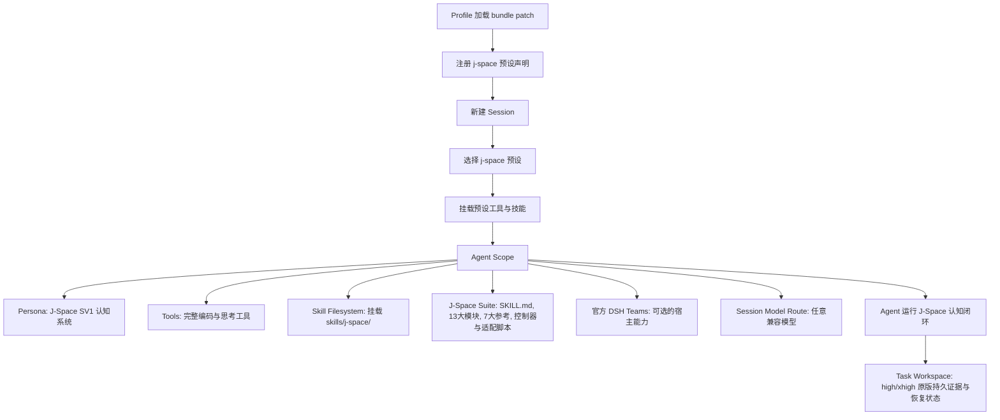

# 🚀 dsh-j-space

[](https://dsh.market/?q=AnonyJcy%2Fdsh-j-space)
[](https://www.npmjs.com/package/@anonyjcy/dsh-j-space)
[](NOTICE.md)

**简体中文** | [English Version](README.en.md)

> **J-Space Cognition Suite SV1** 原生 DeepSeek Harness (DSH) Agent Preset 预设与独立 Cordis 插件包。  
> 保留原版认知引导、持久证据与恢复协议；执行权限及真实智能体生命周期由 DSH 官方能力管理。

---

> **已验证目标：DSH 0.2.1-alpha.3，Cordis 4.0.5-alpha.2；项目版本 1.2.4（2026-10-15）。** 已在全新隔离目录通过官方 CLI 安装 npm 打包产物，验证实际 Loader 预设激活、作用域技能发现与加载，以及官方 Team 关闭/开启两种配置。J-Space 负责认知与任务证据，智能体团队只由 DSH 官方插件管理；不在预设内重复注册直接子代理工具。验证未调用模型、真实团队回合、浏览器或定时到期投递，不代表这些功能的端到端测试。
>
> **请先升级正确的宿主渠道。** 截至该日期，DSH npm `alpha` 为 `0.2.1-alpha.3`，`latest` 仍是旧的 `0.2.0-rc.2`，尚无稳定版 `0.2.1`。旧 `latest` 的干净安装缺少本预设需要的 `@deepseek-ai/dsh-tool-schedule`，实测不能完整激活；本版不宣称兼容该默认配置，请按安装章节显式升级到已验证的 alpha.3。
### DSH 0.2.1 适配要点

- **1.2.0：原生预设注册**。通过 [cordis.patch.yml](./cordis.patch.yml) 中的 `@deepseek-ai/dsh-agent-preset` 声明注册预设，技能目录随包解析，无需额外部署。DSH 自 0.1.7 起不再扫描 `$DSH_HOME/.agent-presets/`，旧 CLI 复制文件的方式不能在 0.2.0 中注册预设。
- **1.2.1：补齐标准工具配置**。加入 `/goal` 命令和 `present` 交付工具，默认配置 `modelSelectionSettings: true`；插件管理工具行与标准预设一致，保持禁用。
- **1.2.2：对齐默认行为**。启用 `web_fetch`（同时保留 `web_search`），显式禁用 Ralph。保留 J-Space 专属 persona 与技能目录。
- **1.2.3：修复开发检查与旧版插件生命周期**。补齐 Node.js 类型声明，增加 `pnpm run typecheck`，修复独立插件在 Cordis 4 中等待不再触发的 `ready` 事件、导致文件部署不执行的问题。原生 bundle 注册方式保持不变。
- **1.2.4：官方团队接管**。补齐时间上下文与定时提醒工具；移除预设内 subagent / fork / control / list-agents 及旧外部代理、Ralph 配置。保留原版 orchestration 的证据、二次考量与独立验收，仅通过 [DSH 权限映射](./preset/skills/j-space/integration/dsh.md) 区分本地证据参与者和真实官方团队；逻辑递归不创建嵌套 Team。

历史上的 DSH 0.1.5 persona schema 与 0.1.6 `dsh-workflow-ptc` 适配记录见 [CHANGELOG.md](./CHANGELOG.md)；它们不代表当前 1.2.x 仍支持所有旧版宿主。

## 🌟 项目简介

`dsh-j-space` 将 [J-Space Cognition Suite](https://github.com/Tiger3807861189/J-Space-Cognition-Suite)（原版 SV1 固定提交，延续 V3.7 演进路线）完整适配为 DeepSeek Harness 的一等公民 **Agent 预设 (Preset)**。

它通过 Cordis **Agent Scope 生命周期隔离、多层认知路由、持久控制器、工作区状态外化账本（`.jspace/`）与自适应验证** 集成到 DSH。模型连接与路由由宿主管理；可选择宿主支持的兼容模型，但不据此保证所有模型可用或具有相同的认知收益。

### ✨ 核心特性
1. **即插即用（Zero-Config Preset）**：部署预设后，DeepSeek Harness 会话创建菜单自动出现 `J-Space Cognition Suite` 预设。
2. **全生命周期 Scope 隔离**：遵循 Cordis 作用域规范，工具和认知技能严格限定在 J-Space Agent 会话中，不污染其他预设。
3. **原版持久验证与恢复**：`high` / `xhigh` 保持 [控制器](./preset/skills/j-space/references/controller.md)、完整源刷新与适用地图/安全验证；DSH 原生任务状态协调执行，认知记录维护证据依赖，不互相替代。低复杂度仍走原版轻量路径。
4. **全面扩展的 13 大认知与工程模块**：除原版的容量控制、深层推理、定向聚焦等模块外，SV1 引入了 `cyber`（安全分析）、`epistemics`（认识论与信念检验）、`orchestration`（原版协作证据协议，真实执行由官方 DSH 管理）和 `repository`（代码仓库工程语义地图）。
5. **宿主管理的模型路由**：不绑定特定模型或提供商；实际模型可用性、权限与路由遵循当前 DSH 配置，跨模型能力收益未经本项目复测。

---

## 🧩 原版深度适配与可校验无损保留

基线固定为 [官方提交 `b2023124a1fa08278e3ee82aefa8ed9faeade995`](https://github.com/Tiger3807861189/J-Space-Cognition-Suite/tree/b2023124a1fa08278e3ee82aefa8ed9faeade995)，不再使用删减认知提示词的轻量替代版本。

- **原版内容完整恢复**：13 个模块、7 个参考、引导/训练、原示例、第一人称操作框架、默认控制器和完整刷新。除 [技能入口](./preset/skills/j-space/SKILL.md) 加入可剥离的 DSH 权限说明外，25 个原版文件逐字节不变；新增 [DSH 适配说明](./preset/skills/j-space/integration/dsh.md) 不覆盖认知规则。
- **DSH 深度适配不等于删除验收**：官方工具管理真实成员、消息、授权与生命周期；本地 `agent add` / `retire` 只是实际参与者的证据记录。保留各参与者自己的源读取、二次考量和独立验收，不能冒用 root 创建假审核身份。官方 Team 只有用户明确请求时才能创建；不可用时如实记录 xhigh solo 限制，不伪造协作。
- **无损是可验证的源内容保证**：[来源与校验清单](./vendor/j-space/manifest.json) 固定提交和 SHA-256，[压缩原版归档](./vendor/j-space/canonical.tar.gz) 可完整还原。校验工具还会剥离入口适配块并与原文逐字节比较，防止把删内容称为适配。
- **不虚报 token 收益**：原版明确把模块头重复前提和定期完整重读作为强化机制，因此默认保留它们，不用摘要/哈希回执取代正文。归档 gzip 压缩的是存储，不会降低解压后模型输入 token；归档是额外的来源备份，也不代表 npm 包整体同等缩小。DSH 仍按原版路由加载相关模块，而非一次加载整套。原版允许基于记录用 `tune` 调整频率，但本次不改变默认值，也未做模型 A/B。

原版脚本仍是便携合作协议，安装预设不会自动安装宿主事件拦截器。完整材料和验收结构可校验，不等于证明模型理解、研究机制或能力表现等同。包装代码与上游材料的授权范围见 [NOTICE.md](./NOTICE.md)。

以下 `pnpm` 开发测试须在完整仓库检出中安装开发依赖后执行；npm 发布包不含这些本地测试脚本。

```bash
pnpm run test:integrity   # 原版校验 + 固定来源/适配边界校验
pnpm run test:controller  # DSH 认知验收契约
pnpm run test:lossless    # 归档校验、防篡改与逐字节还原
pnpm run test:upstream    # 不修改原版测试，用当前适配内容运行
# 隔离宿主须另行安装；真实安装冒烟只创建新的临时 profile，不修改当前 GUI
pnpm run test:host /path/to/isolated-host/node_modules 0.2.1-alpha.3
pnpm run test:install /path/to/isolated-host/node_modules /absolute/plugin.tgz 0.2.1-alpha.3
```

npm 用户可在已安装包的根目录直接运行随包提供的 [校验工具](<tools/upstream_integrity.py>)（Python 3.10+），无需上述测试脚本：

```bash
python3 -B tools/upstream_integrity.py verify --runtime preset/skills/j-space --adapters vendor/j-space/adapters.json
# 输出目录必须尚不存在；不会覆盖已有文件
python3 -B tools/upstream_integrity.py expand --output /tmp/j-space-original-restored
```

---

## 📊 上游实验与评测资料（作者报告，非本适配的验证结果）

- [GLM-5.3-Flash-J-Space-Capability-Realization-Report](https://github.com/Tiger3807861189/GLM-5.3-Flash-J-Space-Capability-Realization-Report)
- [DeepSeek-V4-J-Space-Capability-Realization-Report（早期报告）](https://github.com/Tiger3807861189/DeepSeek-V4-J-Space-Capability-Realization-Report)

这些是上游作者发布的结果与估算，本项目没有独立核验其数据、模型来源或实验方法，也没有在当前 DSH 适配上复现能力、速度或 token 收益。请到原报告查看样本、估算范围与局限；不得将其中数字当作本插件的实测或性能承诺。源内容校验和宿主兼容性检查不能替代模型 A/B 实验。压缩归档中的两份上游 README 保持原样；这里不再重复其评测表格。

---

## 🚀 安装（DSH 0.2.1-alpha.3）

先显式选择目标 DSH 预发布版本，勿把 npm `latest` 当作最新 alpha。下面命令供用户自行执行，会更新本机 CLI；已有部署请先备份配置，并使用启动现有 Web 进程的同一安装环境。

```bash
npm install -g @deepseek-ai/dsh@0.2.1-alpha.3
# 或跟随预发布标签：npm install -g @deepseek-ai/dsh@alpha
dsh --version
```

### 方式一：通过 DSH 插件管理安装（推荐）

```bash
# 1.2.4 发布后，安装到实际使用的 Web profile，而不是任意项目的 node_modules
dsh plugin --profile web add @anonyjcy/dsh-j-space@1.2.4
```

DSH 从包的 `dsh.bundle.patch` 字段加载 [cordis.patch.yml](./cordis.patch.yml)，由其中的声明注册 `j-space`。仅执行 `npm install` / `pnpm add` 到普通项目目录，并不会将预设注册到 DSH profile。

请确认安装的包版本为 **1.2.4 或更新版本**。若 npm 尚未发布对应版本，可使用下面的仓库安装方式。替换已安装的包后，重启当前 DSH Web 进程并新建会话；不要再执行旧版 `install` CLI 作为注册步骤。自定义 Web profile 请将命令中的 `web` 替换为实际 profile 名称。

### 方式二：安装本地仓库版本

```bash
git clone https://github.com/AnonyJcy/dsh-j-space.git
cd dsh-j-space

# 将当前包目录加入 Web profile
dsh plugin --profile web add "$PWD"
```

同样通过 bundle patch 注册预设；技能直接来自包内的 [preset/skills/j-space](./preset/skills/j-space/)，不需要复制到用户预设目录。

---

## 💡 使用方法

### 1. Web UI 界面
1. 打开 DeepSeek Harness Web 界面，点击 **New Session**（新建会话）。
2. 在 **Agent Preset** 下拉选单中，直接选择 **J-Space Cognition Suite**。
3. 选择任意兼容的模型（`deepseek-chat` / `deepseek-reasoner` 等）开始任务。

### 官方「智能体团队」与 J-Space 的边界

需要多智能体协作时，在同一个 Web profile 中启用官方插件（它是可选的实验性功能，不由 J-Space 自动安装）：

```bash
dsh plugin --profile web add @deepseek-ai/dsh-experimental-agent-team-profile@0.2.1-alpha.3
```

- 官方插件负责成员创建、会话、消息、任务分配、生命周期与权限；J-Space 不再注册 `subagent` / `subagent_fork` / 独立成员控制工具。团队成员的模型与预设按官方 DSH 继承规则处理；不再要求 J-Space 的 `modelSelectionSettings` 插件。
- 官方团队 patch 只禁用宿主顶层子代理行，**不会遍历预设的 `config.plugins`**。1.2.4 从预设里直接移除这些行，避免在 J-Space 作用域重新启用第二套入口。
- 13 个原版模块仍完整随包提供。[orchestration 模块](<preset/skills/j-space/modules/orchestration.md>) 保留实际参与者各自读取源文件、第二轮实质考量与独立验收的协议。`agent add` / `retire` 记录真实参与者的任务证据角色，不是官方团队 roster，也不会创建或停止成员；`high` / `xhigh` 的委派结果仍须经过第二轮与独立验收。不得为凑人数或伪造审核注册虚构身份；具体权限边界见 [DSH 适配说明](<preset/skills/j-space/integration/dsh.md>)。
- 未启用官方团队插件时，使用单智能体认知闭环，不模拟团队。自定义宿主自行提供的官方工具仍遵循宿主政策，J-Space 不修改全局配置。
- 保留官方 `workflow` / `workflow-ptc` 及其隔离服务，用于用户明确请求的批量编排。workflow 子任务**不是团队成员**，不能用来绕过团队边界或默认递归生成智能体。

### 2. 升级与自定义 / headless profile

更新同一 profile 的 J-Space 包后，重启当前 DSH Web 进程并新建会话。曾在 Web 编辑器保存的 `preset-j-space.config.plugins` 覆盖配置可能仍保留旧子代理行；请备份自定义设置后重置该预设覆盖，或手动删除所有 `tool-subagent*` 与旧 Ralph 行，再按 1.2.4 配置核对。官方团队插件应在 base / web 层之后加载。

旧版文件部署副本不会被自动覆盖；必要时显式运行 `install` 刷新，但该副本并非当前宿主的注册来源。已有 `.jspace/control.json` schema 和历史记录保留，不要求删除任务证据。

headless / 自定义 profile 不再要求子代理模型选择设置插件。若需要团队，显式配置官方团队宿主能力；若没有，则使用单智能体。预设选择与启动参数以所用 DSH profile 为准，不沿用旧版 `dsh --preset j-space` 示例。

### 3. 旧版独立 Cordis 插件（仅供迁移参考）

```yaml
- id: j-space-plugin
  name: '@anonyjcy/dsh-j-space'
  config:
    autoDeploy: true
```

这段配置仅调用旧版文件部署插件，不是 DSH 0.2.1 的预设注册方式。当前版本请使用上文的 bundle 安装方式。

---

## 🧩 核心架构与数据流



---

## 🛠️ 旧版文件部署 CLI（仅供迁移参考）

以下命令仍保留在包中，管理的是 `$DSH_HOME/.agent-presets/j-space`（默认 `~/.dsh/.agent-presets/j-space`）的旧版副本。`status` / `verify` 只检查这些文件，**不能用于确认 DSH 0.2.1 bundle 已加载或预设已注册**；请在当前 Web profile 的新建会话菜单确认预设是否出现。

```bash
node bin/cli.js install    # 安装 J-Space Preset 到 DSH 用户预设目录 (~/.dsh/.agent-presets/j-space)
node bin/cli.js uninstall  # 干净卸载 J-Space Preset
node bin/cli.js verify     # 校验已安装预设的套件完整性
node bin/cli.js status     # 查看当前安装状态与配置路径
```

---

## 📄 开源许可证

DSH 包装代码采用 [MIT License](<LICENSE>)；上游作者编写的 J-Space 源码与文本采用 [Apache License 2.0](<vendor/j-space/LICENSE>)。包的代码许可证组合为 `MIT AND Apache-2.0`，并非将所有内容重新授权为 MIT。上游外部引文、报道的推理轨迹片段等第三方材料不因此获得 Apache 或 MIT 授权；来源、修改说明及第三方权利边界见 [NOTICE](<NOTICE.md>) 和 [上游第三方声明](<vendor/j-space/THIRD_PARTY_NOTICES.md>)。公开链接、署名或归档不等于再分发许可，发布或复用前须评估适用许可、例外或同意；本项目不作概括性授权保证。原作者与来源见 [上游项目](https://github.com/Tiger3807861189/J-Space-Cognition-Suite)。

## 维护 / Maintenance

版本变更见 [CHANGELOG.md](CHANGELOG.md)。

仅限完整仓库检出的开发校验（npm 发布包不包含本地测试脚本；Python 3.10+，按平台将 `python3` 替换为可用解释器）：

```bash
pnpm install
pnpm run typecheck
pnpm test
pnpm run test:controller
pnpm run test:integrity
pnpm run test:lossless
pnpm run test:upstream
# 可选：目标官方 0.2.1-alpha.3 包的离线集成校验；不启动 Agent 或修改 profile
pnpm run test:host /path/to/dsh-host/node_modules
```
